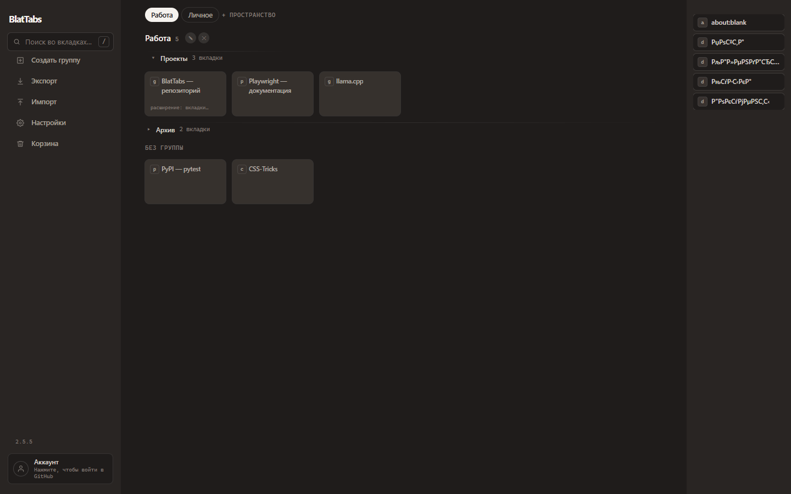

# BlatTabs

**Менеджер сохранённых вкладок для Chrome.** Страница «новой вкладки» (`Ctrl+T`) становится трёхколоночной библиотекой: сохранённые вкладки, пространства и группы — с живым зеркалом открытых вкладок.

- **Версия:** 2.5.5
- **Платформа:** Chrome, Manifest V3 (чистый HTML/CSS/JS, без внешних библиотек)
- **Данные:** хранятся локально на устройстве (`chrome.storage.local`)
- **Проверено:** 986 автотестом (Playwright + pytest)

<!-- Скриншот v2.5.5: реальное UI (тёмная тема), сгенерировано через Playwright с загрузкой unpacked-расширения. -->
<p align="center">
  
</p>

## Установка

**Через «unpacked extension» (из репозитория):**
1. Склонировать репозиторий или скачать zip из [Releases](https://github.com/BlattamRoach/BlatTabs/releases) и распаковать.
2. Открыть `chrome://extensions`.
3. Включить **Developer mode** (переключатель справа вверху).
4. **Load unpacked** → выберите папку расширения.

> BlatTabs переопределяет страницу новой вкладки (`chrome_url_overrides.newtab`).

## Горячие клавиши

| Действие | Клавиши |
| --- | --- |
| Сохранить текущую вкладку | `Ctrl+Shift+S` |
| Открыть BlatTabs (новая вкладка) | `Ctrl+T` |
| Сбросить поиск / выбор (не привязывается) | `Esc` |

Остальные действия настраиваются в Настройках → «Горячие клавиши» (у каждого — свой список комбинаций, «не назначено» — выключено):

| Действие | По умолчанию |
| --- | --- |
| Далее (вниз) | `↓` / `→` |
| Назад (вверх) | `↑` / `←` |
| Открыть вкладку | `Enter` |
| Удалить вкладку | `Delete` / `Backspace` |
| Фокус на поиске | `/` |
| Выбрать все вкладки | `Ctrl+A` |
| Новое пространство | не назначено |
| Новая группа | не назначено |
| Переключить тему | не назначено |
| Открыть настройки | не назначено |

## Данные

Хранятся на устройстве в `chrome.storage.local`. Для переноса на другой браузер или устройство — **Экспорт** (JSON) и **Импорт**. Синхронизация между устройствами — через GitHub-аккаунт (v2.5.0+; карточка «Аккаунт» в левой рейке, данные — в private Gist).

## Разработка

- **Стек:** чистый HTML/CSS/JS, Manifest V3 (service worker).
- **Тесты:** `test_plugin.py` — 986 автотестов (Playwright + pytest, Python 3.14).
  ```bash
  PYTHONDONTWRITEBYTECODE=1 C:\Python314\python.exe test_plugin.py
  ```
  Флаг `PYTHONDONTWRITEBYTECODE=1` обязателен: иначе создаётся `__pycache__` в корне расширения, и Chrome откажется его грузить (имена с `_` зарезервированы).
- **Сборка zip:** `build_zip.py` → `dist/BlatTabs-vX.Y.Z.zip`.
- **Скетчи интерфейса:** `sketches/`; **материалы для магазина:** `store/`.

## История версий

- **2.5.5** — средний клик по карточке — фоновая вкладка; честная ошибка + авто-retry при проверке GitHub-аккаунта; чинка входа в GitHub (OAuth/Device Flow, scope gist); безопасность (javascript:/data:/chrome:// не открываются, валидация импорта, пустой Gist, синк-дебаунс на алармах); приватность (инкогнито вне рейки, системные шрифты, внешних запросов ноль); синк — явный whitelist; FAQ/«О программе» — по-английски; LICENSE (MIT) + PRIVACY.md; автообновление убрано (обновление ручное — через GitHub Releases).
- **2.5.0** — GitHub-синхронизация (аккаунт через Device Flow, синк данных через Gist), корзина с восстановлением, горячие клавиши (10 действий), кастомизация (фоны и ширина реек, 6 разделов настроек, пресеты).
- **2.4.0** — RU/EN (два языка интерфейса + переключатель в настройках), драг группы как таб-карточки, каскадное удаление вкладок, пустые группы не раскрываются, версия в рейке, «Создать группу» в левом блоке.
- **2.3.0** — wordmark «BlatTabs» в рейке, тонкие скроллбары, драг-территории (touch-rule, midpoint-расщепление, FLIP-иммунная геометрия).
- **2.2.0** — поддержка Opera, автообновление из репозитория (фид GitHub Pages), «О программе» в настройках, драг по пустым полосам — отмена.
- **2.1.0** — компактная шапка группы, «Открыть все» (⧉) и авто-разворачивание свёрнутой группы при дропе, переработанный драг (карточка вынимается из сетки, автопрокрутка), карточка 80 px.
- **2.0.0** — трёхколоночный интерфейс, правая рейка живых вкладок, Настройки (фон + цвет вкладок + FAQ).
- **1.0.0** — базовый менеджер сохранённых вкладок (356 автотестов).
