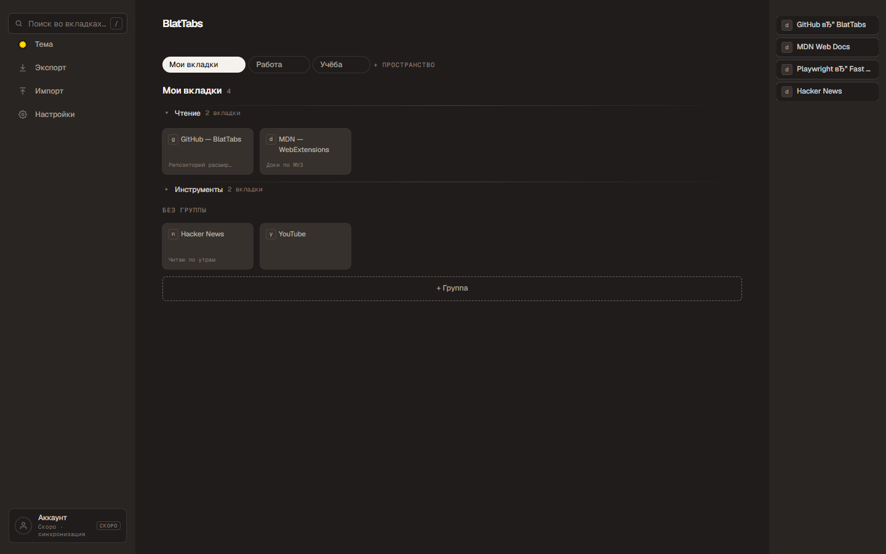

# BlatTabs

**Менеджер сохранённых вкладок для Chrome.** Страница «новой вкладки» (`Ctrl+T`) становится трёхколоночной библиотекой: сохранённые вкладки, пространства и группы — с живым зеркалом открытых вкладок.

- **Версия:** 2.1.0
- **Платформа:** Chrome, Manifest V3 (чистый HTML/CSS/JS, без внешних библиотек)
- **Данные:** хранятся локально на устройстве (`chrome.storage.local`)
- **Проверено:** 532 автотестом (Playwright + pytest)

<!-- Скриншот v2.0.0: реальное UI (тёмная тема), сгенерировано через Playwright с загрузкой unpacked-расширения. -->
<p align="center">
  
</p>

## Установка

**Через «unpacked extension» (из репозитория):**
1. Склонировать репозиторий или скачать zip из [Releases](https://github.com/BlattamRoach/BlatTabs/releases) и распаковать.
2. Открыть `chrome://extensions`.
3. Включить **Developer mode** (переключатель справа вверху).
4. **Load unpacked** → выберите папку расширения.

> BlatTabs переопределяет страницу новой вкладки (`chrome_url_overrides.newtab`).

## Горячие клавиши

| Действие | Клавиши |
| --- | --- |
| Сохранить текущую вкладку | `Ctrl+Shift+S` |
| Открыть BlatTabs (новая вкладка) | `Ctrl+T` |
| Перемещаться между карточками | `←` `↑` `→` `↓` |
| Открыть выбранную вкладку | `Enter` |
| Удалить выбранную карточку | `Delete` / `Backspace` |
| Сбросить поиск / выбор | `Esc` |

## Данные

Хранятся на устройстве в `chrome.storage.local`. Для переноса на другой браузер или устройство — **Экспорт** (JSON) и **Импорт**. Синхронизация между устройствами появится вместе с аккаунтом.

## Разработка

- **Стек:** чистый HTML/CSS/JS, Manifest V3 (service worker).
- **Тесты:** `test_plugin.py` — 532 автотеста (Playwright + pytest, Python 3.14).
  ```bash
  PYTHONDONTWRITEBYTECODE=1 C:\Python314\python.exe test_plugin.py
  ```
  Флаг `PYTHONDONTWRITEBYTECODE=1` обязателен: иначе создаётся `__pycache__` в корне расширения, и Chrome откажется его грузить (имена с `_` зарезервированы).
- **Сборка zip:** `build_zip.py` → `dist/BlatTabs-vX.Y.Z.zip`.
- **Скетчи интерфейса:** `sketches/`; **материалы для магазина:** `store/`.

## История версий

- **2.1.0** — компактная шапка группы, «Открыть все» (⧉) и авто-разворачивание свёрнутой группы при дропе, переработанный драг (карточка вынимается из сетки, автопрокрутка), карточка 80 px.
- **2.0.0** — трёхколоночный интерфейс, правая рейка живых вкладок, Настройки (фон + цвет вкладок + FAQ).
- **1.0.0** — базовый менеджер сохранённых вкладок (356 автотестов).
